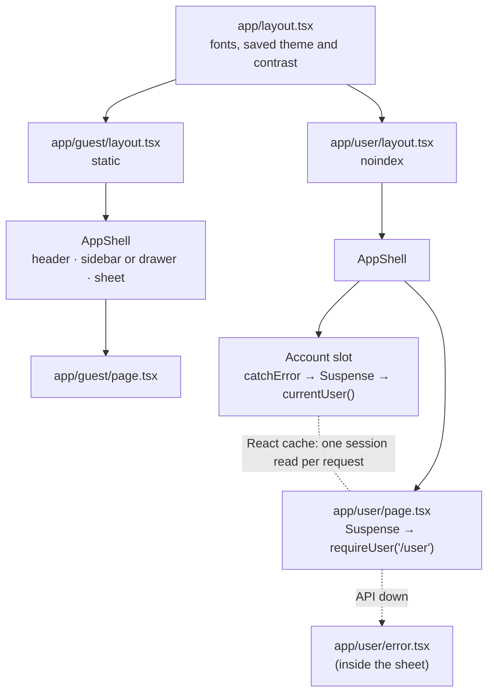

# App shell: architecture

How the shell in `app-shell-design.md` is built: routes, layouts, components, data and state. It covers the frame only; the pages inside it are planned with their own features.

Read the Next.js 16 docs in `node_modules/next/dist/docs/` before changing any of it, at least `03-api-reference/03-file-conventions/layout.md`, `error.md` and `04-functions/catchError.md`. This project runs with Cache Components (`cacheComponents: true` in `next.config.ts`), which changes how layouts may read request data.

## Requirements

What the shell must do:

- Frame `/guest` and `/user` with one header, one sidebar (a drawer below `lg`) and one sheet the page renders into.
- Show where the reader is: the current entry is marked by more than colour (bold text, paper row, outlined marker, `aria-current="page"`).
- Give the tools that work on every page: theme and contrast (the Aa menu), the account menu for readers, and the sign-up nudge for guests.

Non-functional:

- **Accessible:** one `<main>`, a skip link, labelled navigation, keyboard-only use, the two-tone focus ring, no state by colour alone.
- **Fast for guests:** `/guest` reads nothing at request time, so it is prerendered and served as static HTML.
- **Survives the API being down:** the shell still renders; only the account slot and the page show the failure.
- **No dead controls:** a control appears in the live app only when what it does exists. Everything else is shown working on `/design-system` with sample data.

## How the parts fit



## Files

```
src/components/app-shell/          feature-agnostic: plain data and ReactNode slots, never imports features/
  nav-entries.ts                   ShellView, ShellCategory, currentHref(), formatCount(): pure, unit tested
  shell-nav.tsx                    client: <nav aria-label="Feeds">, current entry from usePathname
  shell-drawer.tsx                 client: menu button + native <dialog> holding ShellNav, below lg
  shell-menu.tsx                   a button and a native popover panel (the Aa and account menus)
  shell-header.tsx                 server: the ink bar with the Lemon stripe, logo, drawer slot, actions
  app-shell.tsx                    server: skip link, grid, header, sidebar, <main id="main"> sheet
src/features/preferences/
  html-preference.ts               createHtmlPreference + the one useTheme and useContrast
  components/choice-control.tsx    the radio pills shared by ReadingControls and the Aa menu
  components/appearance-menu.tsx   client: the Aa menu (theme, contrast)
src/features/auth/
  require-user.ts                  currentUser() (no redirect) and requireUser() (redirects)
  components/account-menu.tsx      name, email, Verify email, Change password, Sign out
  components/account-boundary.tsx  client: catchError around the account slot, a Retry control
  components/guest-card.tsx        the guest nudge in the sidebar foot
src/app/guest/layout.tsx           AppShell for guests (static)
src/app/user/layout.tsx            AppShell for readers; metadata robots noindex
```

The pages (`guest/page.tsx`, `user/page.tsx`) and `user/error.tsx` render a `<div>`, not a `<main>`: the shell owns `<main id="main">`. The `/design-system` demo builds the same frame from `ShellHeader`, `ShellDrawer` and `ShellNav` (not `AppShell`, which would nest a second `<main>` and skip link in that page).

## Decisions

### ADR-001: Two layouts, no route group

- **Status:** Accepted
- **Context:** `/guest` and `/user` share the shell but differ in what they read: the reader layout reads the session, the guest one reads nothing.
- **Decision:** `app/guest/layout.tsx` and `app/user/layout.tsx`, each rendering `AppShell` with its own data and slots. No `(app)` route group.
- **Alternatives:** an `(app)` group with one shared layout. It would have to know which mode it is in (from the path, a client concern) and would make `/guest` read the session too, losing its static render. A group without a shared layout only moves folders.
- **Consequences:** a few lines are alike in the two layouts (the views list, `AppShell` props). `robots: { index: false }` lives in `user/layout.tsx`, so every `/user/*` page inherits it.

### ADR-002: The account slot has its own Suspense and error boundary, and never redirects

- **Status:** Accepted
- **Context:** `error.tsx` does not wrap the layout in its own segment, and with Cache Components any session read in a layout must sit in `<Suspense>`. A layout also doesn't know the current path, so a redirect from it would send `/user/saved` back with `next=/user`.
- **Decision:** the reader layout renders `<AccountBoundary><Suspense fallback={…}><Account /></Suspense></AccountBoundary>`. `AccountBoundary` is `catchError` from `next/error` and shows a Retry control. `Account` calls `currentUser()`, which returns the user or null and throws when the API is down; it never redirects. The page keeps `requireUser('/user')`, which redirects with the right return path (a layout redirect would not protect the page's data anyway).
- **Alternatives:** `requireUser` in the layout (wrong return path; an outage escapes to the root, which has no error boundary); a hand-written React error boundary class (`catchError` already handles `redirect()`, `notFound()` and clears on navigation).
- **Consequences:** React `cache` in `require-user.ts` means the layout and the page share one session request. When the API is down, the header shows Retry and the page shows `user/error.tsx` inside the sheet; the shell stays usable.

### ADR-003: Shell components take plain data and slots

- **Status:** Accepted
- **Context:** `components/` must not import a feature (AGENTS.md). The shell needs feature pieces (account menu, Aa menu, guest card).
- **Decision:** `AppShell` takes `homeHref`, `views` (plain objects), `actions` and `foot` (ReactNode). The layouts in `app/` are where features meet the shell.
- **Alternatives:** a `mode: 'guest' | 'reader'` prop with the shell choosing what to render, which would pull features into `components/`.
- **Consequences:** the same parts power `/design-system`, with sample data and every planned control.

### ADR-004: Native dialog and popover, no menu library

- **Status:** Accepted
- **Context:** the drawer needs a modal with focus kept inside; the Aa and account menus need a small panel that closes on Escape and outside clicks. No such component exists yet.
- **Decision:** the drawer is a native `<dialog>` opened with `showModal()` (as `ConfirmDialog` does). It closes on a click on its backdrop or on any link inside it, so it also closes when the reader taps the page they are on. The menus use the `popover` attribute with `popoverTarget` (no JavaScript), placed under their button with CSS anchor positioning (`position-area`) and a fixed-position fallback. They are not `role="menu"`, because they hold ordinary links and buttons.
- **Alternatives:** a headless UI library (a new dependency for two small panels); closing the drawer when the pathname changes (fails when the link is the current page).
- **Consequences:** Escape, focus return and outside clicks come from the browser. Anchor positioning needs a fallback in browsers without it.

### ADR-005: One store each for theme and contrast

- **Status:** Accepted
- **Context:** `createHtmlPreference` makes a separate store each time it is called. The Aa menu and `ReadingControls` both control contrast; two stores would not update each other.
- **Decision:** `html-preference.ts` exports `useTheme`, `useContrast` and their options; everything imports them. The storage keys are written once there (and mirrored in the root layout's early script).
- **Consequences:** radio groups that control the same setting need different `name`s (`appearance-theme`, `appearance-contrast` in the Aa menu), or the browser treats them as one group.

### ADR-006: Categories and navigation data come later

- **Status:** Accepted
- **Context:** each category link needs a category page, and those are part of the feed work. Unread counts need items and read state, which don't exist yet.
- **Decision:** the live sidebar shows only "All items". `ShellNav` already accepts categories and counts, and `/design-system` shows them. Collapsing the sidebar and the layout switch wait too (nothing to collapse, no page reads the layout).
- **Consequences:** see "Later" below for what the category work must add.

## Risks

| Risk                                                                                                                                                      | What we do                                                                                                               |
| --------------------------------------------------------------------------------------------------------------------------------------------------------- | ------------------------------------------------------------------------------------------------------------------------ |
| `usePathname` suspends once a page with a dynamic segment (e.g. `/user/c/[id]`) without `generateStaticParams` sits under the layout, and the build fails | When the category pages land, wrap `ShellNav` in `<Suspense>` with the same nav (no marker) as the fallback              |
| Browsers without CSS anchor positioning                                                                                                                   | `.shell-menu` falls back to a fixed position under the header                                                            |
| The header overflowing at 320px                                                                                                                           | Below `sm`: the small logo, tighter padding, and the guest "Create account" link hidden (the drawer's guest card has it) |
| The API down or slow (5-second timeout in `lib/api.ts`)                                                                                                   | The account slot shows Retry; the page shows `user/error.tsx`; the header and sidebar still work                         |
| `proxy.ts` only checks that a cookie exists                                                                                                               | Unchanged: the page's `requireUser` checks the session and redirects; the layout never trusts the cookie alone           |

## Later (not built now)

- **Navigation data:** a shared `NavigationResponse = { categories: { id: string; name: string; unread: number | null }[]; unreadTotal: number | null }` (`null` = not known yet, so the shell shows no count) and a `navigation` backend module with `GET /api/navigation` (reader, `requireAuth`) and a public guest endpoint.
- **Guest categories:** the `starter_feeds` table is never seeded. The guest endpoint can import `backend/data/sample-feeds.json` directly (`resolveJsonModule` is on and the file ships with the Railway source), or a seed script can fill the table first.
- **Caching:** the default `'use cache'` handler is in-memory per server instance. That is fine for guest navigation (`cacheLife('days')`); a reader's navigation is per person and stays uncached, inside `<Suspense>`.
- **Collapse and layout:** the sidebar collapse (a `data-sidebar` attribute set by the root layout's early script, so it never flashes) and the layout switch (localStorage for guests, `user_preferences.layout` for readers) arrive with the pages that need them.
- **Phones:** settled on the drawer.
