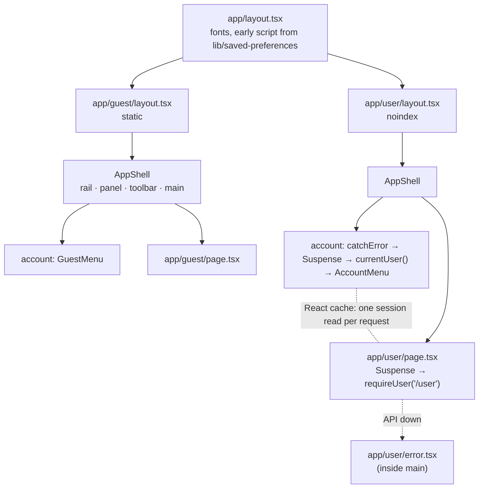

# App shell: architecture

How the shell in `app-shell-design.md` is built: routes, layouts, components, data and state. It covers the frame only; the pages inside it are planned with their own features.

Read the Next.js 16 docs in `node_modules/next/dist/docs/` before changing any of it, at least `03-api-reference/03-file-conventions/layout.md`, `error.md` and `04-functions/catchError.md`. This project runs with Cache Components (`cacheComponents: true` in `next.config.ts`), which changes how layouts may read request data.

## Requirements

What the shell must do:

- Frame `/guest` and `/user` sidebar first: a rail (views, account), a collapsible category panel, and the workspace with its toolbar (location, search, Aa) above the page's `<main>`. Below `lg`, the rail and panel move into a drawer.
- Show where the reader is: the current entry is marked by more than colour (bold text, a field tint, a field bar, `aria-current="page"`), and the toolbar names it.
- Keep three areas apart: navigation in the sidebar, global utilities (search, reader settings) in the toolbar, personal account management in the menu at the sidebar's foot.

Non-functional:

- **Accessible:** one `<main>`, a `<header>` toolbar, skip links to the content and to search, labelled navigation, keyboard-only use (including Ctrl/Cmd + K and `[`), the two-tone focus ring, no state by colour alone.
- **Fast for guests:** `/guest` reads nothing at request time, so it is prerendered and served as static HTML.
- **No flash:** saved preferences (theme, contrast, reading settings, the collapsed sidebar) are on `<html>` before the first paint.
- **Survives the API being down:** the shell still renders; only the account slot and the page show the failure.
- **No dead controls:** a control appears in the live app only when what it does exists; search that has nothing to search says so. Everything else is shown working on `/design-system` with sample data.

## How the parts fit



## Files

```
src/lib/
  saved-preferences.ts             every saved preference (key, data attribute, values) + the early script built from them
  html-preference.ts               client: createHtmlPreference(preference) → a shared hook for one preference
src/components/app-shell/          feature-agnostic: plain data and ReactNode slots, never imports features/
  nav-entries.ts                   ShellView, ShellCategory, currentHref(), shellPlace(), formatCount(): pure, tested
  nav-row.tsx                      a panel/drawer row: field tint (.nav-current), field bar, count, optional menu; FieldDot, AllDots
  category-list.tsx                CategoryTools (add, manage, rowMenu) + the categories as navigation (panel and drawer)
  shell-sidebar.tsx                server: the desktop grid of rail, panel and account (account last in tab order)
  shell-rail.tsx                   client: logo, view icons with tooltips, the panel toggle
  sidebar-toggle.tsx               client: collapses the panel (saved preference, the [ key); RailTooltip
  shell-panel.tsx                  client: the category tools and the categories ("All categories" first); collapses by width
  shell-toolbar.tsx                client: the shell's <header>: drawer button (below lg), location tag, search, utilities
  search-palette.tsx               client: Ctrl/Cmd + K search and jump (native <dialog>, combobox, "Search in" scope)
  search-match.ts                  matchParts(): marks query matches, pure, unit tested
  shell-menu.tsx                   client: a button and a native popover panel (Aa, account, guest, a category's actions)
  shell-drawer.tsx                 client: menu button + native <dialog> holding ShellNav, below lg
  shell-nav.tsx                    client: the drawer's contents (logo, views, categories, account row)
  app-shell.tsx                    server: skip link, rail + panel (lg up), toolbar, <main id="main">
src/features/preferences/
  reader-preferences.ts            client: one hook per reader setting and the options the Aa menu offers
  components/choice-control.tsx    stacked radio pills (the reader settings, the design system's switches)
  components/reader-settings.tsx   client: the Aa popover
src/features/auth/
  require-user.ts                  currentUser() (no redirect) and requireUser() (redirects)
  components/account-menu.tsx      avatar button and menu: name, email, Verify email, Change password, Sign out
  components/guest-menu.tsx        "Guest" button and menu: what an account keeps, Create account, Sign in
  components/account-boundary.tsx  client: catchError around the account slot, a "Try again" control
src/features/categories/
  guest-categories.ts              the guest's curated categories and sources (mirrors backend/data/sample-feeds.json)
  library.ts                       a reader's categories and feeds and the pure edits Manage makes: tested
  components/category-row-menu.tsx client: a category's quick actions (rename, color swatches, Manage, delete)
  components/manage-categories.tsx client: the Manage page body (order, colors, move and unsubscribe feeds, new category)
  components/manage-link.tsx       "Manage" beside the Categories heading; locked for guests
src/features/feeds/
  web-address.ts                   webAddress(): reads a typed site or feed address as a URL, tested
  components/add-feed.tsx          client: Add feed (button + modal form) and AddFeedLocked for guests
src/app/guest/layout.tsx           AppShell for guests (static), with the sample categories and their sources
src/app/guest/c/[category]/page.tsx a guest category's page, prerendered per category (generateStaticParams)
src/app/user/layout.tsx            AppShell for readers; metadata robots noindex
```

The pages (`guest/page.tsx`, `user/page.tsx`) and `user/error.tsx` render a `<div>`, not a `<main>`: the shell owns `<main id="main">`. The `/design-system` demo builds the same frame from `ShellSidebar`, `ShellToolbar` and `ShellDrawer` (not `AppShell`, which would nest a second `<main>` and skip link in that page), with sample categories and a sample `search` function.

## Decisions

### ADR-001: Two layouts, no route group

- **Status:** Accepted
- **Context:** `/guest` and `/user` share the shell but differ in what they read: the reader layout reads the session, the guest one reads nothing.
- **Decision:** `app/guest/layout.tsx` and `app/user/layout.tsx`, each rendering `AppShell` with its own data and slots. No `(app)` route group.
- **Alternatives:** an `(app)` group with one shared layout, which would have to know its mode (from the path, a client concern) and would make `/guest` read the session too, losing its static render.
- **Consequences:** a few lines are alike in the two layouts. `robots: { index: false }` lives in `user/layout.tsx`, so every `/user/*` page inherits it.

### ADR-002: The account slot has its own Suspense and error boundary, and never redirects

- **Status:** Accepted
- **Context:** `error.tsx` does not wrap the layout in its own segment, and with Cache Components any session read in a layout must sit in `<Suspense>`. A layout also doesn't know the current path, so a redirect from it would send `/user/saved` back with `next=/user`.
- **Decision:** the reader layout passes `<AccountBoundary><Suspense fallback={…}><Account /></Suspense></AccountBoundary>` as the shell's `account`. `AccountBoundary` is `catchError` from `next/error` and shows a "Try again" control. `Account` calls `currentUser()`, which returns the user or null and throws when the API is down; it never redirects. The page keeps `requireUser('/user')`.
- **Alternatives:** `requireUser` in the layout (wrong return path; an outage escapes to the root, which has no error boundary); a hand-written error boundary class (`catchError` already handles `redirect()`, `notFound()` and clears on navigation).
- **Consequences:** the shell renders `account` twice (the rail's foot and the drawer's), so the slot reads the session twice; React `cache` in `require-user.ts` makes that, and the page's read, one request.

### ADR-003: Shell components take plain data and slots

- **Status:** Accepted
- **Context:** `components/` must not import a feature (AGENTS.md). The shell needs feature pieces (account and guest menus, the Aa popover).
- **Decision:** `AppShell` takes `homeHref`, `views` and `categories` (plain objects), and `account` and `utilities` (ReactNode). The layouts in `app/` are where features meet the shell. `ShellToolbar` also takes an optional `search` function, which the demo passes and a future search feature will.
- **Alternatives:** a `mode: 'guest' | 'reader'` prop with the shell choosing what to render, which would pull features into `components/`.
- **Consequences:** the same parts power `/design-system`, with sample data. A server layout can't pass a function, so live search arrives through a client wrapper or a Server Action when the data exists.

### ADR-004: Native dialog and popover, no menu library

- **Status:** Accepted
- **Context:** the drawer and the palette need modals with focus kept inside; the Aa, account and guest menus need small panels that close on Escape and outside clicks.
- **Decision:** the drawer and the palette are native `<dialog>`s opened with `showModal()`; the drawer closes on its backdrop or any link inside, the palette on its backdrop, Escape or a result. The menus use the `popover` attribute with `popoverTarget` (ids from `useId`, so a page can hold two), placed by CSS anchor positioning with a fixed-position fallback. They are named non-modal dialogs, not `role="menu"`, because they hold ordinary links, buttons and radios.
- **Alternatives:** a headless UI library (a new dependency for a few small panels).
- **Consequences:** Escape, focus return and outside clicks come from the browser. The palette's query field is a text field, not `type="search"`, so the first Escape closes it rather than clearing it.

### ADR-005: Saved preferences live in one list in lib/

- **Status:** Accepted
- **Context:** theme, contrast, five reading settings and the collapsed sidebar are all saved in localStorage and must be on `<html>` before the first paint. `createHtmlPreference` makes a separate store each time it is called, and the sidebar toggle (in `components/`) can't import from a feature.
- **Decision:** `lib/saved-preferences.ts` lists every preference (storage key, data attribute, allowed values) and builds the root layout's early script from that list; `lib/html-preference.ts` turns one entry into a hook. Each hook is created once: the reader settings in `features/preferences/reader-preferences.ts`, the sidebar in `sidebar-toggle.tsx`. A preference stores only its non-default values ("auto" removes the attribute), and `styles/tokens.css` maps each value to its CSS variables.
- **Alternatives:** keys repeated in the script and the hooks (they drift); continuous sliders saved as numbers (a second kind of preference, and heavier in a small popover).
- **Consequences:** text size and line height are fixed steps. Radio groups that control a setting from two places need different `name`s (the Aa popover takes them from `useId`).

### ADR-006: One current place; guests get their categories now

- **Status:** Accepted (revised after the second critique)
- **Context:** the rail's "All items" and a panel "All categories" row named one URL twice and were both `aria-current`; the live guest shell showed no categories, and search said "nothing to search yet" to a guest with sample feeds.
- **Decision:** `shellPlace()` returns the current view and the current category separately: the rail marks the view (`aria-current="true"`), the panel marks the category, or its "All categories" row on the home page (`aria-current="page"`); the drawer tints one row. Guests' account-only views are listed as `locked` and lead to sign-up. Guests get the five curated categories from `features/categories/guest-categories.ts` (a frontend mirror of `backend/data/sample-feeds.json`), each with a static page at `/guest/c/<id>` (`generateStaticParams`; an unknown id is a 404; Cache Components rejects `dynamicParams`, and `notFound()` covers it). The palette finds views and categories ("Go to") and, from plain `sources` data, the guests' sources; articles wait for the items. Readers' categories, counts and article search still wait for their endpoints.
- **Consequences:** guest category colours are the presets (a guest's recolouring in localStorage isn't read by the shell yet). Because the category route has `generateStaticParams`, `usePathname` resolves at prerender and needs no Suspense; the page itself reads `params` inside a `<Suspense>` child so the static shell never waits on them.

### ADR-007: Category tools are slots, shown working only where their data exists

- **Status:** Accepted
- **Context:** the shell had no place to add feeds or manage categories. The backend has the `categories` and `subscriptions` tables but no endpoints for them yet, and categories have no colour column.
- **Decision:** `AppShell`, `ShellSidebar` and `ShellNav` take `tools: CategoryTools`: `add` (above the categories), `manage` (beside their heading) and `rowMenu(category)` (a quick-actions menu on each row; a function, so only a client parent such as the demo can pass it, and `AppShell` omits it). Guests get Add feed and Manage locked, leading to sign-up. Readers get nothing yet; `/design-system` runs the full set (Add feed, row menus, the Manage page, Undo toasts) on a sample library through `features/categories/library.ts`.
- **Alternatives:** an Add feed button in the toolbar (it would crowd search and Aa); finding feeds through the search palette (hard to discover); showing readers the tools before the API (dead controls).
- **Consequences:** when the endpoints land, `user/layout.tsx` wraps the tools in a client component that calls them, and the Manage page becomes `/user/manage`. Colours come from the brand fields only (`FieldPicker`), so contrast holds in both themes. Unsubscribing asks first (it drops history); renames, colours, moves and deletes apply at once with Undo.

## Risks

| Risk                                                                                                                                                               | What we do                                                                                                                                                                                       |
| ------------------------------------------------------------------------------------------------------------------------------------------------------------------ | ------------------------------------------------------------------------------------------------------------------------------------------------------------------------------------------------ |
| `usePathname` suspends once a page with a dynamic segment without `generateStaticParams` (e.g. readers' `/user/c/[id]`) sits under the layout, and the build fails | Guest categories use `generateStaticParams`. When readers' category pages land, wrap the sidebar, toolbar and drawer nav in `<Suspense>` with the same markup (no current entry) as the fallback |
| Browsers without CSS anchor positioning                                                                                                                            | `.menu-panel` falls back to a fixed spot near its button                                                                                                                                         |
| The toolbar at 320px                                                                                                                                               | Below md the search button is an icon and the tag stays short; checked at 320px                                                                                                                  |
| The API down or slow (5-second timeout in `lib/api.ts`)                                                                                                            | The account slot shows "Try again"; the page shows `user/error.tsx`; navigation still works                                                                                                      |
| The Tailwind Turbopack loader caches a failed CSS compile and doesn't watch `@import`ed files after a failure                                                      | If a CSS error persists after the fix, touch `src/app/globals.css` to force a rebuild                                                                                                            |

## Later (not built now)

- **Navigation data:** a shared `NavigationResponse = { categories: { id: string; name: string; unread: number | null }[]; unreadTotal: number | null }` (`null` = not known yet) and a `navigation` backend module with `GET /api/navigation` (reader, `requireAuth`) and a public guest endpoint. The guest catalogue can import `backend/data/sample-feeds.json` directly; the `starter_feeds` table is never seeded.
- **Categories and subscriptions:** endpoints to list, add, rename, recolour (a `color` column on `categories`), reorder and delete categories, and to subscribe, move and unsubscribe feeds; then the reader's tools, `/user/manage`, and OPML import and export on that page.
- **Search:** an endpoint over articles and sources, per reader, with a category filter; the palette's `search` becomes async when it lands.
- **Caching:** the default `'use cache'` handler is in-memory per server instance, fine for guest navigation (`cacheLife('days')`); a reader's data is per person and stays uncached, inside `<Suspense>`.
